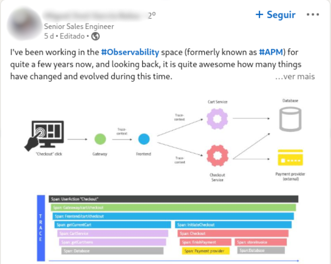

Recentemente, um termo novo começou a circular no mundo da tecnologia: observabilidade. Como acontece com muitos conceitos emergentes, este se baseia em conhecimentos acumulados ao longo das décadas. No entanto, não é raro que novos conceitos sejam confundidos com os antigos, por vezes sendo vistos apenas como uma estratégia de marketing. Neste contexto, algumas empresas começaram a substituir termos em seus materiais de marketing, adaptando-se a essa nova tendência sem realmente alterar seus produtos.

É essencial entender, contudo, que observabilidade difere significativamente do conceito de "monitoramento", conforme já discuti em algumas *lives* e artigos anteriores no blog:

***💡 Monitoramento é querer saber as respostas para perguntas específicas, observabilidade é querer saber as respostas para perguntas que ainda não foram feitas.***

Em suma, enquanto o monitoramento se preocupa em verificar o estado atual de elementos como memória ou filas em uma aplicação específica, a observabilidade permite teorizar sobre o comportamento da aplicação e usar dados de telemetria para validar ou refutar essas teorias. Questões como: "Será que a lentidão está afetando somente usuários em São Paulo ou é um problema geral? Será que impacta apenas clientes VIP ou está relacionado a um método de pagamento específico?" são exemplos do escopo da observabilidade.

## **O Papel do APM Nessa Discussão**

Recentemente, deparei-me com um post em uma rede social que me fez lembrar do equívoco comum de considerar observabilidade e APM (Application Performance Management) como sinônimos:

A postagem dizia: *“Eu tenho trabalhado com observabilidade (anteriormente conhecida como APM) por alguns anos...”*

Para deixar claro: eu não conheço essa pessoa e não conheço a solução que ela vende, e respeito muito todas as pessoas que trabalham nessa empresa e são atuantes no projeto OpenTelemetry.

No entanto, tenho que discordar:

***💡 Observabilidade não é o que antes era conhecido como APM***

A observabilidade mantém-se como a capacidade de explorar dados de telemetria, formulando e respondendo perguntas. Já o APM, por outro lado, oferece visualizações e insights específicos para questões comuns, como identificar os endpoints mais lentos ou as queries SQL que mais impactam o desempenho.

O APM é extremamente útil, mas equiparar observabilidade a APM é um equívoco que pode ser prejudicial tanto para quem extrai valor do APM quanto para quem busca compreender a observabilidade em sua plenitude.
